## 📜 목차

- [프로젝트 소개](#프로젝트-소개)
- [기술 스택](#기술-스택)
- [배포 구조](#배포-구조)
- [해결한 문제](#해결한-문제)
- [예매 플로우](#예매-플로우)
- [핵심 기술 선택 이유](#핵심-기술-선택-이유)
- [성능 측정 결과](#성능-측정-결과)
- [트러블슈팅](#트러블슈팅)
- [DB 인덱스 최적화](#db-인덱스-최적화)
- [참조 문서](#참조-문서)

---

<a id="프로젝트-소개"></a>

## 🙋‍♂️ 프로젝트 소개

**TicketFlow는 지정 좌석 없이 공연별 티켓 수량을 관리하는 예매 서비스입니다.** 초과 예매·중복 결제·보상 누락·미결제 방치 문제를 재현하고, 성능 개선과 장애 복구를 단계적으로 구현했습니다.

티켓팅 서비스에서 "좌석이 1개 남았는데 2명이 예매됐다", "결제가 실패했는데 좌석이 돌아오지 않았다" 같은 문제는 왜 생기는 걸까. 이 프로젝트는 그 질문에서 출발했습니다.

처음에는 `SELECT ... FOR UPDATE`로 잔여석을 직렬화하면 충분하다고 봤습니다. 정합성은 지켜졌지만 500명 동시 요청에서 평균 응답 시간이 3.7초까지 올라갔습니다. Redis로 좌석 제어를 옮겼더니 이번엔 예상치 못한 위치에서 deadlock이 발생했습니다. "결제 실패 직후 즉시 보상"이 직관적이라고 생각했는데, 실패 주입 실험에서 보상 호출 자체도 같은 비율로 유실됐습니다.

매 단계마다 "이렇게 하면 될 것 같다"는 가설이 틀렸고, 부하 테스트와 실험 코드로 직접 확인한 뒤에야 다음 구조로 넘어갔습니다.

이 프로젝트에서 중점적으로 고민한 것은 세 가지입니다.

- **정합성 vs 처리량** — Lock 범위를 어디까지 잡아야 초과 예매를 막으면서도 응답 시간이 견딜 만한가
- **멱등성의 범위** — "중복 요청 차단"과 "동일 결과 반환"은 같은 문제가 아니다. 정상 재시도와 동시 중복 클릭은 서로 다른 방어선이 필요하다
- **보상의 완결성** — 결제 실패 사실을 DB에 기록하는 것과 보상 대상을 기록하는 것은 별개의 작업이다. 같은 트랜잭션에 묶이지 않으면 앱이 재시작할 때 보상 대상 정보가 사라진다

### 현재 구현과 문서 안내

현재 실행 환경은 **로컬**이며, 아래 GCP/AWS 구성과 과거 성능 수치는 당시 검증 기록입니다. 소스·검증 JAR·실행 중인 시연 앱의 버전은 별도로 확인해야 합니다.

- **예매:** 요청을 DB에 먼저 기록하고 Redis Lua로 티켓을 확보합니다. DB 저장 장애 시 최초 선점부터 5분간 생성 재시도가 가능하며 다른 앱의 Worker가 복구합니다. 결제는 사용자가 별도로 진행합니다.
- **결제:** PG 호출 전 진행 정보를 커밋하고 승인·취소 결과가 불명확하면 재조회합니다. 결제 완료와 예매 확정은 같은 DB 트랜잭션으로 처리합니다.
- **보상:** 확정 실패·전액 취소와 반환 Outbox를 함께 저장하고, 예매 요청별 Lua로 중복 반환을 방지합니다.
- **기한:** 입장권은 발급부터 10분, 예매 생성 복구는 최초 선점부터 5분, 미결제 만료 후보는 Booking 생성부터 30분입니다. 5분 내 복구 완료를 보장하거나 키 TTL로 자동 반환하는 구조가 아닙니다.

[현재 구조·상태·한계](docs/architecture.md) · [정상/장애 흐름](docs/flow.md) · [로컬 실행·테스트](docs/testing.md) · [전체 문서 안내](docs/README.md)

대표 근거: [예매 생성 복구](docs/booking-hold-recovery-results.md), [로컬 PG SIGKILL·경합 12회](docs/payment-saga-fault-results.md), [실제 Toss 테스트 취소](docs/toss-live-cancel-final-results.md). 최신 기능 변경 후 전체 k6는 재측정하지 않았습니다. 아래 개발 과정은 당시 구현과 측정 조건을 함께 읽어주세요.

### 📊 예상 트래픽 및 인프라 설계 기준

**시나리오 가정**: DAU 15,000명, 저녁 8시 티켓 오픈, 5분 이내에 10,000명이 대기열에 진입합니다.

이 시나리오를 기반으로 부하를 세 가지로 나눠서 접근했습니다.

| 순위 | 부하 유형 | 엔드포인트 | 계산 |
|---|---|---|---|
| 1순위 | 대기열 진입 spike | `POST /queue` | 10,000명 / 300초 ≈ **33 req/s** (단시간 집중) |
| 2순위 | 대기열 polling 지속 부하 | `GET /queue/me` | 10,000명 × 1/5s = **2,000 req/s** (고정 polling 기준) |
| 3순위 | 예매 동시성 | `POST /booking` | 입장권 발급 후 대기자들이 집중적으로 예매 요청 (정합성 중심) |

polling이 진짜 병목입니다. 대기열 진입은 33 req/s에 불과하지만, 진입 후 모두가 5초마다 순번을 조회하면 서버는 2,000 req/s를 계속 받습니다. Adaptive Polling(`position > 1,000`이면 10초 간격)을 적용하면 이론상 **1,100 req/s**로 줄어듭니다.

이 수치를 목표 기준으로 잡고 AWS EC2 2대 → GCP 3대 + GCP LB로 단계적으로 검증했습니다.

### 📹 데모 영상

https://github.com/user-attachments/assets/ea70e348-7d5c-41cd-af44-f2d95484a94a

---

<a id="기술-스택"></a>

## 🛠️ 기술 스택

### Backend


### Data / Auth


-4B4B4B?style=for-the-badge&logoColor=white)


### Frontend


### Infra / Monitoring / Testing


---

<a id="배포-구조"></a>

## 🌐 배포 구조

### 초기 검증 구조 — AWS EC2 2대 + Nginx

초기 다중 서버 검증은 AWS EC2 2대와 Nginx 로드밸런서로 진행했습니다. 프리티어와 작은 VM 스펙에서 처리 가능한 부하를 확인했습니다.

```
사용자 브라우저
    │
    ▼
Vercel (React 프론트엔드)
    │  /api/* 요청 → Vercel rewrites로 EC2로 프록시 (CORS 해결)
    ▼
Nginx (EC2 #1, 포트 80 — 로드 밸런서)
    │  Round-Robin
    ├──────────────────────────┐
    ▼                          ▼
Spring Boot app-1          Spring Boot app-2
(EC2 #1, Docker)           (EC2 #2, Docker)
    │                          │
    └──────────┬───────────────┘
               ▼
          MySQL + Redis
          (EC2 #1, Docker, 공유)
```

당시 공연 포스터 등은 Cloudinary CDN을 통해 제공했고, CI/CD는 GitHub Actions → Docker 이미지 빌드 → EC2 배포 순으로 자동화했습니다.

### 확장 검증 구조 — GCP 앱 3대 + Load Balancer

이후 더 큰 규모의 부하 실험과 스케일업·스케일아웃 비교를 위해 GCP로 이전했습니다.

```
사용자 브라우저
    │
    ▼
Vercel (React 프론트엔드)
    │
    ▼
GCP HTTP(S) Load Balancer
    ├──────────────────────────┬──────────────────────────┐
    ▼                          ▼                          ▼
Spring Boot app-1          Spring Boot app-2          Spring Boot app-3
(Server1)                  (Server2)                  (Server3)
    │
    ├── MySQL
    ├── Redis
    ├── Prometheus
    └── Grafana
```

- **Server1**: Spring Boot app + MySQL + Redis + Prometheus + Grafana
- **Server2/3**: Spring Boot app only
- 대기열 성능 측정은 이 **GCP Load Balancer + app 3대** 구성을 기준으로 진행했습니다.

### 현재 개발·검증 환경 — 로컬

현재는 로컬에서 개발 및 검증합니다. 다중 서버 장애 검증은 앱 3대가 MySQL·Redis를 공유하는 독립 Docker 환경을 실행해 수행하며, 앱 3대가 항상 가동 중이라는 의미는 아닙니다.

[로컬 실행과 격리 조건](docs/testing.md) · [앱 3대 실행기](perf/README.md) · [최신 예매 자동 복구 검증](docs/booking-hold-recovery-results.md)

---

<a id="해결한-문제"></a>

## 💡 해결한 문제

| 문제 | 현재 대응 방식 | 상세 근거 |
|---|---|---|
| **동일 공연 행 갱신 경합·초과 예매** | 요청별 Lua로 티켓 확보를 원자 처리하고, 매 예매마다 수행하던 공연 예약 수 UPDATE 제거 | [재고·트랜잭션 구조](docs/architecture.md), 아래 성능 측정 기록 |
| **티켓 확보 후 DB 저장 실패·서버 종료** | 요청을 먼저 DB에 기록하고 최초 확보부터 5분간 예매 생성을 재시도. 다른 서버도 같은 요청을 복구하며 중복 차감 방지 | [예매 생성 복구·검증](docs/booking-hold-recovery-results.md) |
| **중복 승인 요청** | 기존 주문 결과 재사용, DB에서 최초 승인 호출 선점, 동일한 PG 멱등키와 주문 유니크 제약 적용 | [현재 결제 흐름](docs/flow.md#pg-승인과-결과-재확인) |
| **PG 응답 유실·결제와 예매의 불일치** | Saga로 실제 승인·취소 결과를 재조회. 취소 결정 후 늦은 승인 응답이 예매를 다시 확정하지 못하도록 보호 | [앱 3대 결제 장애·경합 12회](docs/payment-saga-fault-results.md) |
| **보상 작업 유실·중복 반환** | 확정 실패·전액 취소와 반환 Outbox를 같은 DB 트랜잭션으로 저장. 요청별 Lua로 반환 기록과 재고 증가를 원자 처리 | [취소·Outbox 커밋 예외 검증](docs/payment-cancel-commit-fault-results.md) |
| **미결제 예매 방치** | 예매 생성 후 30분을 넘긴 후보를 확인하되, 미확정·완료 결제가 있으면 취소·반환 보류 | [만료·보상 보호 흐름](docs/flow.md#취소outbox반환) |
| **여러 결제 Worker의 재시도 경합** | 같은 재시도 회차의 실패가 횟수와 다음 시각을 중복 갱신하지 않도록 선택 당시 정보와 현재 DB를 비교 | [수정 전후 검증](docs/payment-retry-round-fix-results.md) |
| **대기열 등록·조회 부하** | Redis 대기열과 순번별 Polling·Jitter 적용. 조회 빈도 제어와 과거 GCP 앱 3대의 처리 용량 검증은 구분 | [대기열 구조](docs/architecture.md#대기열과-재고), 아래 부하 측정 기록 |

이 표는 현재 대응 방식의 요약입니다. 초기 방식·대안 비교·변경 이유와 당시 성능 수치는 아래 상세 사례에 보존했습니다. Redis SETNX를 사용한 3계층 멱등성은 Mock 결제 경로의 개발 기록이며, 현재 외부 PG 승인 경로와 구분합니다.

전략 비교는 `experiments/`, 최신 장애·동시성 회귀는 실제 MySQL·Redis 통합 테스트, 서버 종료와 자동 Worker 복구는 독립 다중 앱 실행기로 검증했습니다. 모든 문제를 같은 실험 패키지나 동일 환경에서 검증한 것은 아닙니다.

---

## 🔄 예매 플로우

### 시스템 아키텍처

MVP에서는 DB row lock으로 좌석을 제어했으나, 부하 테스트에서 hot row 병목을 확인한 뒤 "실시간 제어는 Redis, 영속 상태 저장은 DB"로 역할을 분리했습니다.

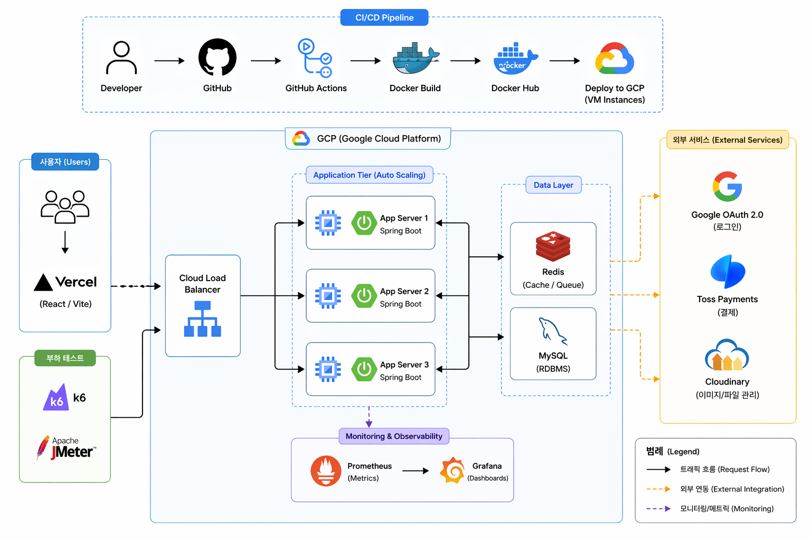

<details>
<summary>이전 아키텍처 — AWS EC2 2서버 + Nginx</summary>

<br>

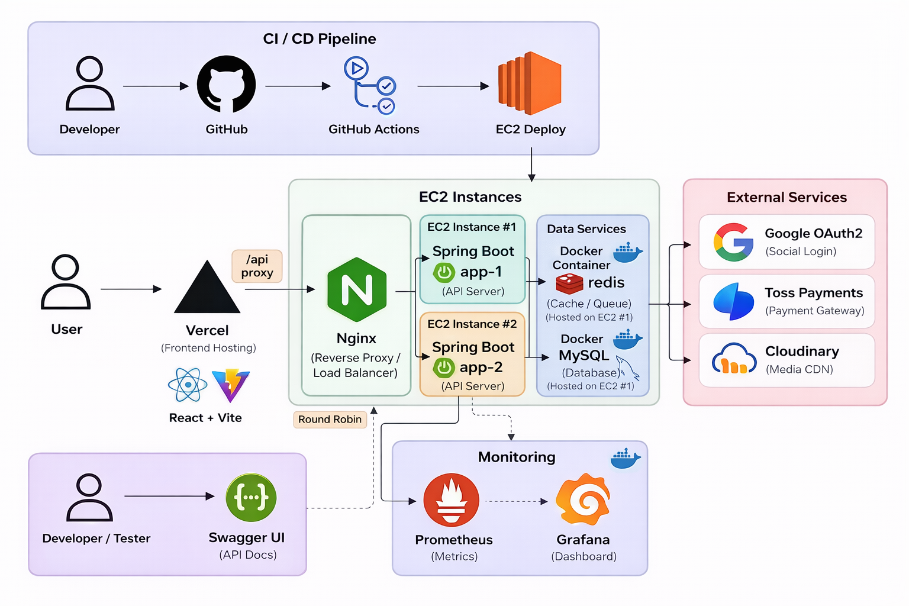

</details>

<details>
<summary>초기 아키텍처 — 단일 서버 (AWS Elastic Beanstalk → EC2)</summary>

<br>


> 초기 배포는 AWS Elastic Beanstalk으로 시작했으나, 비용 절감과 직접 제어를 위해 EC2 + Docker + Nginx 구성으로 전환했습니다.

</details>

### 예매 플로우

> 아래는 이전 입장권 소비·재고 차감 및 Mock 결제 경로의 개발 기록입니다. 현재 운영 경로는 요청별 Lua 선점과 DB 요청 복구, PG Saga를 사용합니다. [최신 흐름](docs/flow.md)을 확인하세요.

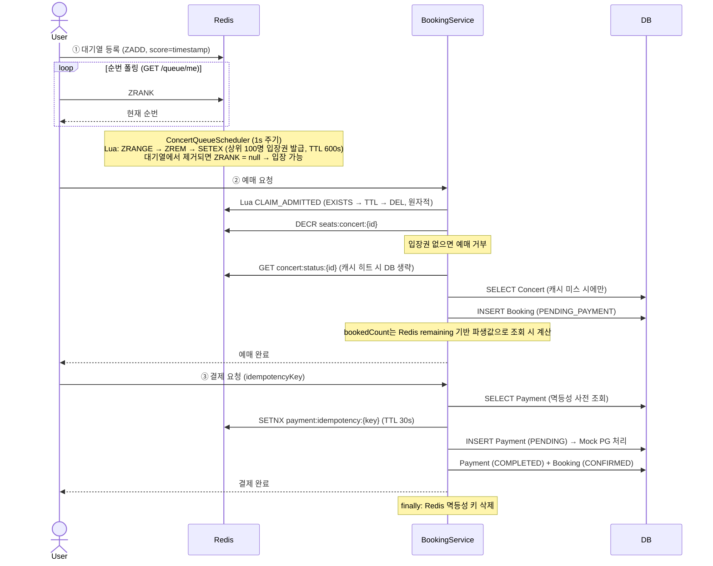

### 결제 실패 보상 플로우

> 아래 도식은 이전 Mock·반환 구현 기준입니다. Outbox 사용은 유지하지만 현재 반환은 예매 요청 ID 기반 공통 Lua를 사용하며, 이미 취소된 Booking도 미완료 반환을 재개할 수 있습니다. PG timeout을 즉시 실패 보상으로 처리하지 않습니다. [현재 보상 흐름](docs/flow.md#취소outbox반환)을 확인하세요.

보상을 "결제 실패 직후 즉시 호출"로 먼저 구현했지만, 실패 주입 실험에서 보상 호출 자체도 같은 비율로 유실됐습니다.
현재는 보상 사실을 Outbox에 남기고, 스케줄러가 좌석 복구와 상태 전환을 책임집니다.

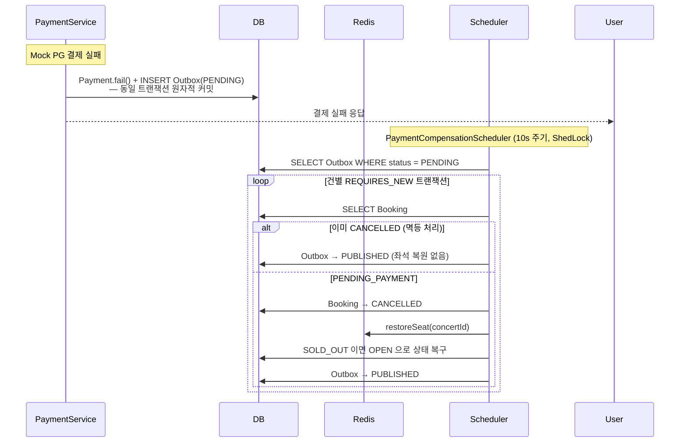

---

<a id="핵심-기술-선택-이유"></a>

## 🔥 핵심 기술 선택 이유

> 개발 당시의 대안 비교와 측정 기록입니다. 현재도 유지되는 선택과 이전 호출 경로가 함께 있으며, 최신 트랜잭션·잠금·복구 기준은 [아키텍처](docs/architecture.md)를 따릅니다. Outbox 주기 10초는 실행 주기이지 장애 시 최대 보상 완료 시간 보장은 아닙니다.

<details>
<summary><strong>Redis Sorted Set + Lua Script — 대기열을 왜 Redis로 옮겼고, 왜 Lua가 필요했나</strong></summary>

### 처음에는 이렇게 생각했습니다

DB 테이블 하나로 대기열을 구현해도 충분하다고 봤습니다. `INSERT INTO queue (user_id, created_at)` 후 `COUNT(*)` 로 순번을 계산하면 단순하고 이해하기 쉽습니다.

### 문제를 확인했습니다

티켓팅 오픈 순간에는 등록보다 조회가 훨씬 많습니다. 수백 명이 짧은 주기로 순번을 폴링하면 `COUNT(*)` 쿼리가 반복되고, 대기열 읽기 비용이 그대로 DB에 쌓였습니다.

### 대안을 비교했습니다

**DB 테이블**: 구현이 단순하지만, 순번 조회 쿼리가 폴링마다 반복돼 고동시성에서 DB 부하가 집중됩니다.

**Redis List**: LPUSH/LINDEX로 순번 조회는 가능하지만, 중간 삭제(입장 처리 시 LREM)가 O(N)입니다. 대기열 규모가 커질수록 입장 처리 비용이 선형으로 늘어납니다.

**Redis Sorted Set**: ZADD O(log N), ZRANK O(log N)으로 순번 조회, ZREM O(log N)으로 삭제. score를 등록 타임스탬프로 설정하면 선착순 순서가 자동으로 유지되고, 모든 주요 연산이 O(log N)입니다.

Sorted Set도 단점이 있습니다. List보다 메모리를 더 씁니다. 수백만 명 규모라면 skip list 오버헤드가 무시할 수 없습니다. 그러나 티켓팅 대기열은 이벤트 오픈 직후 수백~수천 명 수준이고, 입장 처리 후 빠르게 줄어드는 특성이 있습니다. 이 규모에서는 조회 성능 이점이 메모리 트레이드오프를 상쇄합니다.

### Sorted Set만으로는 부족했습니다

Sorted Set을 선택한 뒤 새 문제가 생겼습니다. 입장권 발급이 `ZRANGE → ZREM → SETEX` 세 단계인데, 이 사이에 스케줄러가 두 번 실행되거나 프로세스가 죽으면 어떻게 될까요.

- ZREM은 됐는데 SETEX 전에 프로세스가 죽으면 → 대기열에서 빠졌지만 입장권이 없는 사용자 발생
- 스케줄러가 거의 동시에 두 번 실행되면 → 같은 사용자에게 입장권 중복 발급

원자성을 보장하는 방법을 세 가지 비교했습니다.

**Java 순차 호출**: 구현이 가장 단순하지만, 세 명령 사이에 다른 요청이 끼어들 수 있습니다. 원자성이 없습니다.

**Redis MULTI/EXEC with WATCH**: WATCH로 감시하던 키가 변경되면 EXEC가 무효화되고 재시도가 필요합니다. 동시 요청이 많은 구간에서 WATCH 실패가 자주 발생하면 재시도 루프가 필요해지고, "단순한 원자 연산"이 "재시도를 제어하는 복잡한 코드"가 됩니다.

**Lua Script**: Redis 서버 내부에서 단일 스레드로 실행되어 재시도 없이 원자성이 보장됩니다. 스크립트 오류 시 디버깅이 어렵고, 복잡한 스크립트는 서버 응답을 블로킹할 수 있습니다. 그러나 세 줄짜리 연산이라면 이 트레이드오프가 납득됩니다.

```lua
-- POP_AND_GRANT: 대기열 상위 N명을 꺼내 입장권 발급 (원자적)
local users = redis.call('ZRANGE', queueKey, 0, count - 1)
if (#users == 0) then return users end
redis.call('ZREM', queueKey, unpack(users))
for i = 1, #users do
  redis.call('SETEX', admittedPrefix .. users[i], ttl, '1')
end
return users
```

입장권 소비(`EXISTS → TTL → DEL`)도 같은 이유로 Lua Script를 사용합니다. 반환값으로 남은 TTL을 받아, DB 처리 실패 시 입장권을 원래 잔여 TTL로 복원하는 데도 활용했습니다.

```lua
-- CLAIM_ADMITTED: 입장권 확인 + 원자적 소비, 남은 TTL 반환
if redis.call('EXISTS', key) == 0 then return -1 end
local ttl = redis.call('TTL', key)
redis.call('DEL', key)
return ttl
```

### 결과

대기열 순번 조회가 DB polling이 아닌 Redis ZRANK 단일 명령으로 처리됩니다. 입장권 발급과 소비는 Lua Script로 원자성을 보장해 중복 발급과 TOCTOU 문제를 방지했습니다.

</details>

<details>
<summary><strong>DB Lock — 낙관적 락과 비관적 락 중 어느 쪽이 티켓팅에 맞는가</strong></summary>

### 처음에는 이렇게 생각했습니다

Optimistic Lock과 Pessimistic Lock 중 하나를 고르면 해결될 거라고 생각했습니다. 충돌이 많으면 비관적 락, 드물면 낙관적 락이라는 통념에서 시작했고, "낙관적 락이 처리량이 높다"는 설명을 보고 처음엔 낙관적 락을 먼저 고려했습니다.

### 낙관적 락의 트레이드오프를 확인했습니다

낙관적 락은 충돌이 드문 환경에서 비관적 락보다 처리량이 높습니다. DB 자원을 커밋 시점에만 잡기 때문입니다. 그러나 이 이점은 "충돌이 드문 환경"이라는 전제에서만 성립합니다.

티켓팅 오픈 직후는 "거의 모든 요청이 같은 좌석 row를 읽고 UPDATE하는 구간"입니다. 충돌은 예외가 아니라 정상 상태입니다.

```
[낙관적 락 시나리오]
50개 스레드 동시 요청 → 1개만 커밋 성공 → 49개 OptimisticLockException
→ 재시도 → 또 충돌 → 재시도 무한 반복
→ 응답 지연 누적, DB 커넥션 점유 증가
```

재시도 횟수를 제한해도, 실패한 요청들이 에러로 끝나는 건 동일합니다. 낙관적 락의 장점은 이 구간에서 발현되지 않습니다.

### 비관적 락의 트레이드오프를 비교했습니다

비관적 락은 락을 잡은 트랜잭션이 완료할 때까지 다른 트랜잭션이 대기합니다. 재시도 없이 순차 처리됩니다. 크리티컬 섹션이 길면 대기 시간이 누적되는 문제가 있습니다.

그러나 잔여석 차감은 단순 UPDATE 연산입니다. 락 유지 시간이 짧아 대기 비용이 크지 않습니다. 더해서, Redis 대기열이 이미 진입 인원을 50명 단위로 나눠 입장시키기 때문에 실제 동시에 좌석을 차감하는 인원도 제한됩니다. 락 경합 자체가 크지 않다는 점도 비관적 락을 선택하는 데 유리하게 작용했습니다.

### 결과

초과 예매를 막았습니다. 부하 테스트에서 "정합성은 확보됐지만 고동시성 처리량은 부족한 구조"라는 다음 문제를 확인했고, 이후 Redis 좌석 차감으로 개선했습니다.

</details>

<details>
<summary><strong>Redis 좌석 차감 + 파생 bookedCount — deadlock 원인이 예상 밖에 있었다</strong></summary>

### 처음에는 이렇게 생각했습니다

DB 락 구조에서 벗어나면 응답 시간이 좋아질 것 같아, 좌석 제어를 Redis `decrementSeat`로 옮겼습니다. 이때도 예약 성공 수를 바로 확인하고 싶어서 `concert.booked_count = booked_count + 1` 업데이트는 유지했습니다.

### 예상치 못한 위치에서 deadlock이 발생했습니다

JMeter 동시 예약 테스트에서 일부 요청이 500으로 실패했고, 로그에 아래 예외가 남았습니다.

```text
MySQLTransactionRollbackException: Deadlock found when trying to get lock; try restarting transaction
```

Redis로 좌석 제어를 옮겼는데 왜 DB deadlock이 생길까요. `BookingService.book()` 흐름을 따라가봤습니다. `booking INSERT` 직후 `incrementBookedCount()`를 호출해 `concert.booked_count`를 즉시 UPDATE하고 있었습니다. 좌석 점유는 Redis가 처리했지만, 모든 성공 요청이 여전히 같은 `concert` 행을 UPDATE하고 있었습니다. `booking INSERT`가 잡는 인덱스/외래키 락과 `concert` UPDATE 락이 같은 트랜잭션 안에서 섞이면서 deadlock이 발생했습니다.

### deadlock 제거를 위한 선택지를 비교했습니다

**방법 1: concert UPDATE를 별도 트랜잭션으로 분리**
`@Transactional(REQUIRES_NEW)`로 booked_count만 따로 UPDATE하면 두 락이 같은 트랜잭션에서 충돌하지 않습니다. deadlock은 해소되지만 모든 요청이 같은 concert 행을 UPDATE하는 hot row 문제는 그대로 남습니다. 응답 시간 병목이 형태만 바뀝니다.

**방법 2: booked_count를 비동기로 갱신**
`@Async`나 이벤트로 booked_count 갱신을 뒤로 미루면 동기 병목을 줄일 수 있습니다. 하지만 갱신이 지연되는 구간에 조회하면 stale한 값이 반환됩니다. 정합성보다 조회 성능을 우선하는 설계입니다.

**방법 3: bookedCount를 파생값으로 전환**
booked_count UPDATE를 완전히 제거하고, 조회 시 `totalSeats - Redis remainingSeats`로 계산합니다. 즉시 갱신할 필요가 없어 hot row 자체가 사라집니다.

단점이 있습니다. Redis가 내려가면 실시간 잔여석 값을 구할 수 없습니다. 이 경우 fallback으로 DB에 저장된 마지막 `bookedCount`를 사용하고 경고 로그를 남기는 방식으로 완화했습니다. Redis를 실시간 제어 도구로 쓰는 이상 Redis 가용성에 대한 의존이 생기는 건 피할 수 없고, fallback을 명시적으로 설계하는 것이 더 나은 접근이라고 판단했습니다.

방법 1은 hot row를 남겨두고, 방법 2는 stale 조회를 허용합니다. 방법 3을 선택했습니다.

### 결과

concert 행을 매 요청마다 갱신하던 hot row update가 사라졌고, 동일 시나리오에서 deadlock 없이 병렬 처리가 가능해졌습니다.

</details>

<details>
<summary><strong>3계층 멱등성 — "unique key 하나면 되지 않나"에서 시작한 고민</strong></summary>

> Mock 결제 경로의 개발 기록입니다. 아래 비교·실험 결과는 보존하며, 외부 PG 경로는 DB 승인 호출 선점과 PG 멱등키·결과 재조회를 사용합니다. [현재 결제 흐름](docs/flow.md#pg-승인과-결과-재확인)을 참고하세요.

### 처음에는 이렇게 생각했습니다

DB에 `uk_payment_idempotency_key` unique constraint 하나를 두면 충분하다고 생각했습니다. 중복 요청이 들어오면 INSERT가 실패하고 호출자가 이미 처리됐다는 걸 알 수 있으니까요.

`experiments/e3`에서 세 전략을 각각 실험하면서 이 생각이 틀렸다는 걸 확인했습니다.

### 세 전략이 서로 다른 상황에서 무너졌습니다

**전략 A — DB unique key만 사용**

중복 요청이 거의 동시에 들어오면 두 요청 모두 비즈니스 로직 초반을 통과합니다. INSERT 시점에야 충돌이 드러나는데, 그 전에 이미 결제 관련 로직이 실행된 상태입니다. 충돌을 앞단에서 차단하지 못합니다.

두 번째 문제가 있습니다. 이미 성공한 결제를 사용자가 재시도하는 경우, unique constraint 예외로 처리하면 클라이언트 입장에서는 "결제 실패"처럼 보입니다. 멱등성의 본래 의미는 "같은 요청이 들어왔을 때 기존 결과를 그대로 반환하는 것"인데, unique key만으로는 그 반환 처리를 할 수 없습니다.

**전략 B — SELECT EXISTS → INSERT**

이미 처리된 재시도는 빠르게 걸러낼 수 있고, 기존 결과를 반환하기도 쉽습니다. 그러나 SELECT와 INSERT 사이에 동시 요청이 끼어들면 둘 다 SELECT에서 "없음"을 보고 INSERT로 진입합니다. 동시 중복 클릭에 취약합니다.

**전략 C — Redis SETNX만 사용**

동시 요청 차단에는 효과적입니다. 그러나 Redis가 장애 상태면 방어선이 통째로 사라집니다.

### 세 계층이 서로 다른 실패 시나리오를 담당하도록 조합했습니다

실험을 통해 각 전략이 담당할 수 있는 상황이 다르다는 것을 확인했습니다. 세 계층을 조합하면 각각의 취약점을 서로 보완합니다.

| 계층 | 역할 | 대응 상황 |
|---|---|---|
| DB 사전 조회 | 이미 처리된 요청이면 기존 결과 즉시 반환 | 정상 재시도 |
| Redis SETNX (TTL 30s) | 동일 키의 동시 요청을 앞단에서 차단 | 동시 중복 클릭 |
| DB unique key | Redis 장애 시 최후 방어선 | Redis 장애 |

3계층은 구현 복잡도를 높입니다. 계층이 많을수록 버그가 숨을 자리도 많아집니다. 그러나 각 계층이 서로 다른 실패 모드를 담당하고, 하나가 동작하지 않아도 나머지가 보완하는 구조이기 때문에 결제라는 도메인에서는 이 복잡도가 납득됩니다.

### 결과

`PaymentServiceFailRateTest` — 동일 idempotencyKey로 재요청 시 기존 결과가 반환됨을 검증합니다. Grafana 대시보드에서 `MOCK/CACHED` 분포로 중복 결제가 실제로 차단되고 동일 결과가 반환됐음을 확인했습니다.

</details>

<details>
<summary><strong>결제 Saga·Outbox — PG 결과 불일치와 보상 작업 유실에 대응하기</strong></summary>

### DB 트랜잭션만으로 외부 결제까지 되돌릴 수 없었습니다

초기에는 DB 트랜잭션 안에서 PG 승인을 요청했습니다. 하지만 PG가 승인한 직후 DB 저장에 실패하거나 서버가 종료되면, DB는 롤백돼도 실제 결제는 남을 수 있었습니다. 승인 응답의 타임아웃도 실제 승인 실패를 의미하지 않으므로, 예외만 보고 티켓을 반환하면 이미 결제된 티켓을 다른 사용자에게 판매할 위험이 있었습니다.

결제 실패 후 직접 보상을 호출하는 방식도 문제가 있었습니다. `experiments/e4`의 N번째 호출 예외 주입 실험에서는 보상 호출 자체가 실패하는 경우를 확인했습니다. 실패 기록과 보상해야 한다는 사실을 별도로 처리하면, 서버 종료 후 미완료 보상을 찾을 영속 기록이 부족했습니다.

### 2PC 대신 Saga를 적용한 이유

2PC는 참여 자원들이 준비(prepare)와 최종 커밋·롤백 프로토콜에 참여해야 합니다. 현재 연동한 PG는 승인·조회·취소 HTTP API를 제공하며, 이를 MySQL 트랜잭션과 함께 준비·커밋하는 인터페이스로 사용하지 않습니다. 따라서 DB 트랜잭션을 길게 유지해도 PG와 DB가 함께 커밋되거나 롤백되는 것은 아닙니다. 현재 연동에서는 두 시스템을 2PC로 묶을 수 없다는 점이 우선적인 제약이었습니다.

이에 각 단계의 결과를 DB에 기록하고, 실제 PG 결과에 따라 다음 처리나 보상을 결정하는 Saga 방식을 적용했습니다. 승인됐으면 예매 확정을 재시도하고, 확정할 수 없어 취소가 결정되면 전액 취소를 진행합니다. 결과가 불명확하면 즉시 보상하지 않고 재조회합니다. 이미 실행된 외부 결제를 DB 롤백으로 없애는 대신 별도의 취소 거래로 보상하므로, 중간 불일치와 보상 실패를 추적·재처리하는 책임은 애플리케이션에 남습니다.

### Choreography 대신 Orchestration을 선택한 이유

Choreography는 각 참여자가 이벤트를 받아 다음 동작을 결정합니다. 독립 서비스들이 이벤트로 협력하는 구조에 사용할 수 있지만, TicketFlow는 예매와 결제가 같은 Spring Boot 앱·MySQL 안에 있습니다. 이 구조에서 확정·재조회·취소 판단을 여러 이벤트 처리기로 나누면 취소 의도 이후 도착한 승인 응답이나 만료·보상 경합의 처리 순서를 여러 곳에서 추적해야 합니다.

Orchestration은 하나의 조정 로직이 현재 진행 상태를 보고 다음 작업을 결정합니다. TicketFlow에서는 기존 `PaymentSaga` 서비스에 PG 결과 검증과 확정·취소 판단을 모아, 상태 전이와 복구 순서를 한곳에서 확인하도록 했습니다. 별도 Saga 프레임워크나 이벤트 브로커는 추가하지 않았습니다. 이는 서비스 수가 많아서가 아니라, 현재 앱 구조에서 결제 처리의 판단 근거와 책임을 명확하게 유지하기 위한 선택입니다.

조정 로직에 책임이 모이는 단점은 있습니다. 또한 특정 프로세스의 메모리에만 진행 상황이 있다면 그 서버 장애가 복구를 막을 수 있습니다. 이를 피하려고 진행 상태를 MySQL에 커밋하고, 다른 앱의 Worker가 이를 읽어 같은 조정 로직을 재개하도록 했습니다. PG 호출은 DB 트랜잭션 밖에서 수행하고, 결과 적용은 Booking→Payment 순서의 잠금과 현재 상태 검증으로 보호합니다. 모든 앱이나 DB가 불가한 동안에도 복구된다는 뜻은 아닙니다.

### Saga로 결과를 판단하고 Outbox로 반환 작업을 보존했습니다

승인 요청 전에 주문 식별자·금액·PG 조회 정보와 진행 상태를 먼저 커밋하고, 최초 승인 호출 선점을 별도로 커밋한 뒤 PG를 호출합니다. 동일 주문은 기존 결과를 재사용하고 저장된 PG 멱등키를 유지합니다.

승인 응답이 유실되면 Worker가 PG를 조회합니다. 승인 완료가 확인되고 예매 확정이 가능하면 결제 완료와 예매 확정을 같은 DB 트랜잭션으로 저장합니다. 취소가 결정되면 의도를 먼저 저장하고 PG 전액 취소를 요청합니다. 조회·취소 응답이 불명확하면 재확인하며, 취소 의도 이후 도착한 승인 결과가 예매를 다시 확정하지 못하도록 보호합니다.

반환 작업의 저장·전달 방식도 비교했습니다.

| 방법 | 현재 구조에서의 판단 |
|---|---|
| 직접 호출·Fire-and-forget | 단순하지만 미완료 작업을 영속 기록하지 않으면 서버 종료 후 재처리 대상을 찾기 어려움 |
| `@Async`와 메모리 기반 재시도 | 호출 스레드는 분리해도 대기 작업의 재시작 후 복구는 보장하지 않음 |
| Kafka에 직접 발행 | 브로커·Consumer 운영이 추가되며 DB 커밋과 이벤트 발행 사이의 유실 문제도 별도로 해결해야 함 |
| DB Transactional Outbox와 스케줄러 | 기존 MySQL에 결제 종료와 반환 작업을 함께 커밋하고 미완료 작업을 재처리할 수 있음 |

확정 실패 또는 전액 취소가 확인되면 해당 결과와 반환 Outbox를 하나의 DB 트랜잭션에 저장합니다. 이후 스케줄러가 공통 반환 로직을 실행합니다. 반환 여부 확인·재고 증가·반환 완료 기록은 예매 요청 ID 기준의 Redis Lua로 원자 처리하므로, 반환 직후 종료돼도 재실행 시 중복 증가를 막습니다.

Kafka와 Outbox는 양자택일이 아닙니다. Kafka로 전달하더라도 DB 변경과 발행을 연결하는 데 Outbox를 사용할 수 있습니다. 현재는 대량 이벤트 전달보다 미완료 보상의 보존·복구가 필요했으므로 기존 MySQL과 스케줄러를 사용했습니다. 대신 DB 폴링과 보상 지연을 감수합니다. 스케줄러는 10초 주기지만 장애·재시도까지 포함한 최대 완료 시간을 보장하지는 않습니다.

### 장애를 주입해 확인했습니다

초기 보상 실패 주입 실험에서는 Outbox 재처리로 해당 실험 조건에서 최종 보상 성공을 확인했습니다. 이 결과를 모든 장애의 100% 복구 보장으로 해석하지 않습니다. 일반 보상 오류는 최대 3회 재시도 후 FAILED로 남기고, 보류는 일반 실패와 구분합니다. 실패 지표를 Prometheus·Alertmanager·Slack에 연결하고 관리자 API로 재시도하는 흐름을 구성했습니다.

후속 검증은 실제 MySQL·Redis와 로컬 모의 PG, 앱 3대 환경에서 수행했습니다. PG 승인 직후 SIGKILL 3회, 전액 취소 직후 SIGKILL 3회에서 다른 앱이 자동으로 확정 또는 보상을 완료했습니다. 취소 확인 중과 취소·반환 완료 후에 오래된 승인 응답이 도착하는 두 상황도 각각 3회 검증해, 총 12회에서 취소 상태 역전과 중복 반환이 없음을 확인했습니다.

로컬 장애 주입과 실제 Toss 테스트 연동은 구분합니다. 취소 의도는 테스트 fixture로 준비했으며 일반 사용자 환불 API나 실제 PG 장애 전체를 검증한 결과는 아닙니다.

[처리 흐름·잠금·한계](docs/flow.md) · [로컬 PG SIGKILL·경합 12회](docs/payment-saga-fault-results.md) · [취소·Outbox 커밋 예외](docs/payment-cancel-commit-fault-results.md) · [실제 Toss 테스트 취소](docs/toss-live-cancel-final-results.md) · [보상 실패 알림·관리자 재시도](docs/payment-compensation-alerting.md)

개념 참고: [AWS Saga 패턴의 두 방식](https://docs.aws.amazon.com/prescriptive-guidance/latest/cloud-design-patterns/saga-patterns.html), [Toss 승인·조회·취소 API](https://docs.tosspayments.com/reference). 선택 근거는 해당 개념을 현재 코드 구조에 적용한 판단이며, 두 Saga 방식을 구현해 성능을 비교했다는 의미는 아닙니다.

</details>

<details>
<summary><strong>예매 생성 자동 복구 — 즉시 반환에서 구매 기회 유지로</strong></summary>

### Redis로 경합을 줄인 뒤 저장소 간 실패 구간이 남았습니다

동일 공연 행의 갱신 경합을 줄이기 위해 티켓 수량은 Redis에서 관리하고 개별 예매 내역은 MySQL에 저장하도록 분리했습니다. Redis 내부의 확인·차감은 Lua로 원자 처리할 수 있지만, 이후 MySQL 저장까지 하나의 트랜잭션으로 묶이는 것은 아닙니다.

예를 들어 Redis 잔여 수량이 10장에서 9장으로 줄어든 직후 예매 저장에 실패하면, 사용자는 티켓을 확보했지만 DB에는 예매 내역이 없는 상태가 됩니다. 초기에는 예외를 감지한 코드에서 재고를 되돌렸지만, 차감 직후 서버가 강제 종료되면 그 코드 자체를 실행할 수 없었습니다. 또한 DB 커밋은 성공하고 응답만 유실됐을 수 있으므로 모든 예외를 저장 실패로 판단해 반환하는 것도 안전하지 않았습니다.

### 즉시 반환과 선점 유지의 비용을 비교했습니다

| 방법 | 장점과 한계 |
|---|---|
| 저장 실패 시 즉시 반환 | 재고를 빠르게 풀 수 있지만, 일시적인 DB 장애에도 먼저 티켓을 확보한 사용자가 구매 기회를 잃음. 서버 종료 후 미완료 작업을 찾는 장치도 별도로 필요 |
| 기한 없이 티켓 유지 | 사용자의 구매 기회는 유지되지만 복구되지 않는 요청이 판매 가능한 재고를 장시간 점유 |
| 기한을 둔 확보·자동 복구 | 일정 시간 기존 티켓으로 저장을 재시도하고, 완료할 수 없으면 확인 후 반환. 진행 기록·기한·중복 실행 제어가 필요 |

세 번째 방식을 선택하고 최초 확보부터 5분을 예매 생성 복구 기한으로 정했습니다. 구매 기회 유지와 재고 장기 점유 사이의 프로젝트 정책이며, 측정으로 최적임을 입증한 시간은 아닙니다. 재요청 때마다 기한을 연장하면 계속 점유할 수 있으므로 최초 시각을 유지했습니다.

### 요청을 먼저 기록하고 티켓 확보와 예매 저장을 연결했습니다

1. **차감 전에 요청을 기록:** 요청 식별자·사용자·공연과 처리 중 상태를 MySQL에 별도 커밋합니다. 서버가 종료돼도 다른 서버가 미완료 요청을 찾을 근거입니다.
2. **요청별 티켓 확보:** Redis Lua로 입장권 확인·소비, 재고 차감, 해당 요청의 확보 기록과 복구 기한 저장을 원자 처리합니다. 같은 요청을 다시 실행해도 재차감하거나 기한을 갱신하지 않습니다.
3. **예매와 처리 완료를 함께 저장:** 해당 요청 행을 잠근 트랜잭션 안에서 예매 내역 생성과 요청의 완료 기록을 함께 커밋합니다. 예매만 저장되거나 완료 표시만 남지 않도록 묶었습니다.

대기열 입장권은 예매를 시작할 권한이고, Redis의 티켓 확보 기록은 이미 차감한 재고의 소유 이력입니다. 복구에서는 입장권을 다시 소비하거나 대기열부터 다시 시작하는 대신 기존 확보 기록을 사용합니다. 처음부터 확보하지 못한 요청을 복구 작업이 새로 차감하는 것은 아닙니다.

### 서버 종료 후에는 다른 서버가 저장 결과부터 확인합니다

애플리케이션이 저장 예외를 감지하면 새 트랜잭션의 잠금 조회로 DB 결과를 먼저 확인합니다. 서버가 종료돼 해당 확인조차 못 한 경우에는 5초 주기로 후보를 조회하는 복구 Worker가 요청을 찾아 같은 잠금 아래 처리합니다. 실제 선택은 요청별 재시도 시각을 따르므로 모든 요청이 정확히 5초마다 재시도되는 것은 아닙니다.

| 확인 결과 | 복구 동작 |
|---|---|
| 예매 저장과 요청 완료가 이미 커밋됨 | 기존 결과 재사용. 추가 차감·반환 없음 |
| 예매가 없고 기존 확보 기록이 유효하며 생성 가능 | 확보한 티켓으로 예매 생성과 처리 완료를 함께 커밋 |
| 복구 기한이 지났거나 공연 종료 등으로 생성 불가 | DB 상태를 확인하고 반환 필요 상태를 먼저 커밋한 뒤 공통 반환 실행 |
| DB·Redis 결과 불명확 또는 확보 기록 손상 | 임의로 생성·반환하지 않고 재확인 대상으로 유지 |

원래 요청과 여러 서버의 Worker는 같은 요청 행을 잠그므로, 원래 트랜잭션이 끝나기 전에 저장 실패로 단정해 티켓을 반환하지 않습니다. DB 유니크 제약도 함께 유지해 중복 예매를 막습니다. 반환 시에는 요청별 반환 여부 확인·재고 증가·반환 완료 기록을 같은 Lua에서 처리하므로, Redis 반환 직후 서버가 종료돼 다시 실행하더라도 수량은 한 번만 증가합니다.

### 사용자는 같은 요청의 결과를 확인하고 결제를 이어갑니다

화면은 요청 ID를 같은 탭의 sessionStorage에 보관합니다. 처리 중 응답을 받으면 동일 요청 상태를 주기적으로 조회하고, 새로고침해도 같은 ID를 유지합니다. 복구된 예매가 결제 대기 상태라면 결제 화면으로 이동하며 PG 승인을 자동 실행하지 않습니다. 브라우저를 닫아도 Worker는 처리를 이어가고, 생성된 예매는 내 예매에서 확인할 수 있습니다.

5분은 예매 생성을 다시 시작할 수 있는 기한이며, Redis 키가 자동 삭제되거나 티켓이 정확히 5분 뒤 반환된다는 뜻은 아닙니다. 생성된 예매의 미결제 만료 기준은 생성 시점부터 별도의 30분입니다. DB·Redis 장애가 지속되면 안전한 확인·반환도 지연됩니다. Redis 데이터 유실 복구와 손상 기록의 자동 정합성 재구축까지 보장하는 구조는 아닙니다.

### 실제 DB 장애·강제 종료·화면 복구로 확인했습니다

- **실제 MySQL 저장 거부:** 티켓 확보 후 INSERT가 실패하도록 제약을 두고, 재고와 요청이 유지되는 것을 확인했습니다. 제약 제거 후 Worker가 추가 차감 없이 예매를 생성했습니다.
- **앱 3대 실프로세스 4개 시나리오:** 선점 직후 SIGKILL 후 다른 앱의 자동 생성, DB 커밋 후 SIGKILL·응답 유실, 다중 앱 중복 요청, 미선점 요청 종료 후 늦은 실행을 검증했습니다.
- **실제 5분 경과:** 저장 실패를 유지한 채 기본 기한이 지나도록 기다려 자동 Worker의 반환을 확인했습니다. 이 테스트의 실행 시간은 302.08초였으며 최대 복구 시간 보장으로 해석하지 않습니다.
- **브라우저 흐름:** 저장 실패 → 처리 중 표시 → 새로고침 후 요청 유지 → 장애 제거 → 자동 복구 후 결제 화면 이동을 확인했습니다. 이 검증에서는 실제 PG 결제를 실행하지 않았습니다.

관련 선택 회귀 164건, 별도 실제 5분 테스트 1건, 실프로세스 4개 시나리오가 통과했습니다. 164건은 결제·만료·Outbox 등을 포함하고 상속 테스트가 반복 실행된 건수이며, 이 기능만의 독립 사례 수나 저장소 전체 테스트 수는 아닙니다. 최신 기능 변경 후 전체 k6는 재측정하지 않았습니다.

[정책·배포 조건과 한계](docs/booking-hold-recovery.md) · [실행 환경·결과·원본 위치](docs/booking-hold-recovery-results.md) · [상태와 잠금의 코드 근거](docs/architecture.md) · [테스트 실행 방법](docs/testing.md)

</details>

---

<a id="성능-측정-결과"></a>

## 📈 성능 측정 결과

> 아래 JMeter·AWS/GCP 수치는 각 당시 버전·환경의 기록입니다. 현재 선점 유지·결제 복구 버전의 성능을 뜻하지 않으며, 서로 다른 환경의 수치를 직접 비교하지 않습니다. [로컬 동일 조건 비교](docs/booking-performance-optimized-results.md)와 [계측](docs/booking-success-path-timing-results.md)은 별도 기록입니다.

동시성 제어 구조를 먼저 정리하고, 그 다음 서버를 늘리는 순서로 진행했습니다.

| 단계 | 환경 | 핵심 결과 |
|---|---|---|
| Phase 1 | 로컬 단일 서버 | DB Lock → Redis 개선. 응답시간 62% ↓, deadlock 제거 |
| Phase 2 | AWS EC2 2대 + Nginx | 수평 확장으로 응답시간 9배 개선 (13.8s → 1.5s) |
| Phase 3 | GCP e2-medium 2~3대 + GCP LB | 대기열 진입 10,000명 0% 에러. 예매 동시성 Redis 캐시 + pool 튜닝으로 74.1 TPS. 1,000 req/s polling 안정화. Adaptive Polling으로 2,000 → 1,100 req/s |

<details>
<summary><strong>Phase 1 — 로컬 단일 서버: DB Lock → Redis 구조 개선 과정</strong></summary>

### 1. 개선 전: DB Lock 기반 구조

처음 구조에서는 초과 예매를 막는 데 집중했습니다. 실제로 정합성은 잘 지켜졌지만, 좌석 수와 동시 요청 수가 늘수록 직렬화 비용이 빠르게 커졌습니다.

| 시나리오 | 평균 응답 시간 | p95 | 처리량 | 결과 해석 |
|---|---:|---:|---:|---|
| 100석 / 100명 | 162ms | 257ms | 334.4/sec | 낮은 지연 시간으로 안정 처리 |
| 100석 / 300명 | 1310ms | 1609ms | 133.9/sec | 실패율 66.67%, 좌석 초과 요청은 정상적으로 마감 처리 |
| 300석 / 300명 | 1146ms | 1941ms | 143.8/sec | 전부 성공, 다만 응답 지연이 커짐 |
| 500석 / 500명 | 3778ms | 6822ms | 69.8/sec | 전부 성공, 정합성은 유지됐지만 직렬 처리 한계 확인 |

### 2. 커넥션 풀 증가 실험 (Hikari pool 10 → 50) — 더 느려졌다

DB Lock 구조에서 응답 시간이 길어지는 걸 보고, 처음 든 생각은 "커넥션 풀이 부족해서 요청이 대기하는 건 아닐까?"였습니다. Hikari pool 사이즈를 10에서 50으로 늘리면 더 많은 요청이 동시에 처리될 것이라고 예상했습니다.

결과는 예상과 반대였습니다.

| 지표 | pool=10 | pool=50 |
|---|---:|---:|
| 평균 응답 시간 | 3778ms | 5656ms |
| p95 | 6822ms | 9650ms |
| TPS | 69.8/sec | 49.8/sec |
| 에러율 | 0% | 0% |

커넥션 풀을 5배 늘렸더니 응답 시간이 약 50% 더 늘어났습니다.

**왜 더 나빠졌는지 InnoDB lock 통계로 확인했습니다.**

테스트 전후로 MySQL InnoDB row lock 누적 지표를 수집했습니다.

| 지표 | pool=10 이후 | pool=50 이후 | 증가량 |
|---|---:|---:|---:|
| `Innodb_row_lock_waits` | 5,586 | 6,085 | +499 |
| `Innodb_row_lock_time` (ms) | 201,222 | 594,108 | +392,886ms |
| 평균 락 대기 시간 | — | — | 392,886 / 499 ≈ **787ms** |

pool=50 조건에서 row lock 한 번 대기에 평균 787ms가 소요됐습니다.

**원인 해석**: 커넥션 풀을 늘리면 더 많은 트랜잭션이 동시에 DB에 진입할 수 있습니다. 그런데 이 구조에서는 모든 성공 요청이 같은 `concert` 행의 Pessimistic Lock을 잡으려 합니다. 동시에 진입하는 트랜잭션이 많아질수록 같은 row를 두고 경합하는 수가 늘어나고, lock 대기 줄이 길어집니다. 커넥션 풀 부족이 병목이 아니었습니다. 더 많은 요청을 동시에 DB로 밀어 넣을수록 lock 경합이 심해지는 구조가 문제였습니다.

이 실험을 통해 "서버 자원 증설보다 구조 변경이 먼저"라는 판단의 근거를 직접 확인할 수 있었습니다.

### 3. 1차 개선 후: Redis 좌석 차감 도입

좌석 제어를 Redis `decrementSeat`로 옮기면 병렬성이 좋아질 거라고 판단했습니다. 실제로 DB row lock 병목은 줄었지만, 예약 성공 직후 `concert.booked_count`를 즉시 UPDATE하던 로직이 새로운 문제를 만들었습니다.

```text
MySQLTransactionRollbackException: Deadlock found when trying to get lock; try restarting transaction
```

`booking INSERT` 이후 같은 트랜잭션 안에서 `concert.booked_count`를 갱신하면서 동일 공연 행이 hot row가 됐고, 일부 요청이 500으로 실패했습니다.

### 4. 최종 개선: bookedCount 파생값 전환

- 좌석 정합성: Redis `decrementSeat` / `restoreSeat`
- DB 역할: `booking INSERT`, 상태 저장, 보상 이력 저장
- `bookedCount`: `totalSeats - remainingSeat`로 조회 시 계산

이후 같은 500석 / 500명 시나리오를 다시 측정했습니다.

| 시나리오 | 평균 응답 시간 | p95 | 처리량 | 에러율 |
|---|---:|---:|---:|---:|
| 500석 / 500명 | 1445ms | 2518ms | 186.6/sec | 0% |

### 5. 개선 전 vs 개선 후

| 지표 | 개선 전 | 개선 후 | 개선율 |
|---|---:|---:|---|
| Avg 응답 시간 | 3778ms | 1445ms | 약 62% 감소 |
| p95 | 6822ms | 2518ms | 약 63% 감소 |
| TPS | 69.8/sec | 186.6/sec | 약 167% 증가 |
| Error | 일부 500 + deadlock | 0% | 안정성 확보 |

### 6. JMeter & Grafana 결과

#### 개선 전 JMeter 결과

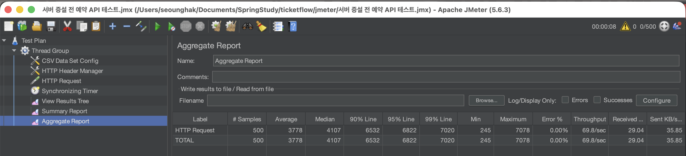

개선 전에는 좌석 정합성은 유지됐지만, 요청이 몰릴수록 DB row lock 대기로 응답 시간이 급격히 증가했습니다.

#### 개선 후 JMeter 결과

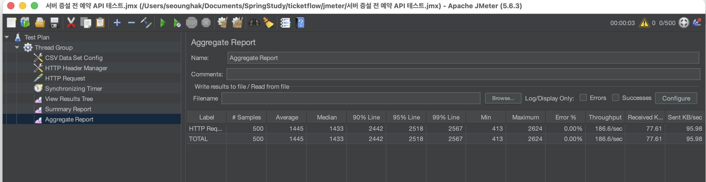

`bookedCount`를 파생값으로 전환한 뒤에는 deadlock 없이 동일 시나리오를 처리했고, 평균 응답 시간과 처리량이 함께 개선됐습니다.

#### Grafana 대시보드

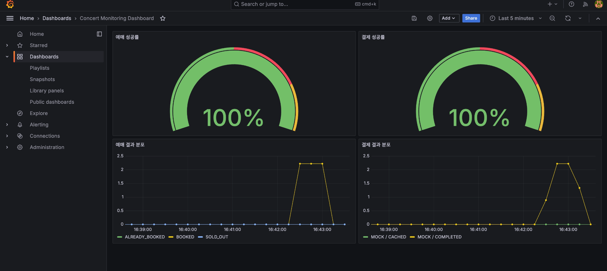

예약 결과 분포와 보상 처리 상태를 통해, 단순히 빨라졌는지만 본 것이 아니라 실패 유형과 정합성까지 함께 확인했습니다.

| 분포 항목 | 의미 |
|---|---|
| `BOOKED` | 예매 성공 |
| `ALREADY_BOOKED` | 중복 예매 시도 → 차단됨 |
| `SOLD_OUT` | 잔여석 없음 |
| `MOCK/COMPLETED` | 결제 성공 |
| `MOCK/CACHED` | 멱등성 키로 재반환 (중복 결제 차단) |

</details>

<details>
<summary><strong>Phase 2 — EC2 실서버: 수평 확장 효과 검증</strong></summary>

구조 개선 이후 실제 EC2 환경에서 단일 서버와 2서버 구성을 동일 조건(300명 동시 요청)으로 비교했습니다.

**테스트 환경**
- EC2 #1: Nginx(로드 밸런서) + app + MySQL + Redis (t3.micro)
- EC2 #2: app only, EC2 #1의 MySQL·Redis 공유 (t3.micro)
- JMeter: SyncTimer 300명 동시 출발, 300석 콘서트

### EC2 1서버 결과

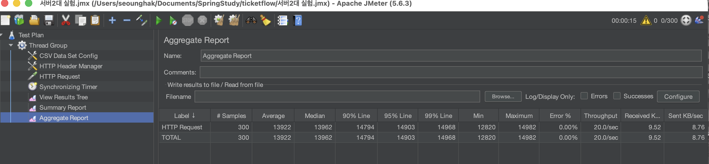

### EC2 2서버 결과 (Nginx 로드 밸런싱)

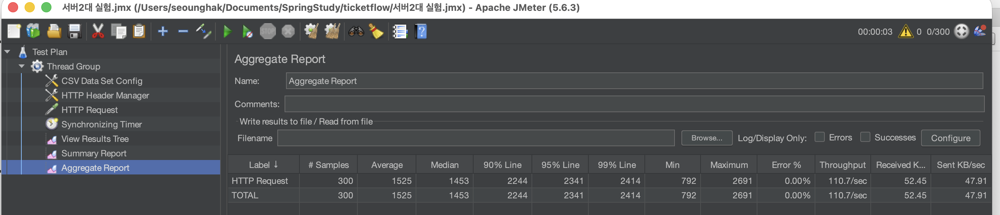

### EC2 1서버 vs 2서버 비교

| 구성 | 평균 응답 시간 | p95 | TPS | 에러율 |
|---|---:|---:|---:|---:|
| EC2 1서버 | 13,822ms | 14,903ms | 20/sec | 0% |
| EC2 2서버 (Nginx LB) | **1,525ms** | **2,341ms** | **110.7/sec** | **0%** |
| 개선율 | **9배 빠름** | **6.4배 빠름** | **5.5배 향상** | 유지 |

t3.micro 단일 서버는 300명 동시 요청에서 CPU 크레딧 소진과 JVM GC 압박이 겹쳐 13초대 응답이 발생했습니다. 서버를 1대 추가해 Nginx가 요청을 절반씩 분산하자 각 서버의 부하가 줄어 응답 시간이 9배 개선됐습니다.

에러율은 두 구성 모두 0%입니다. Redis 원자적 좌석 차감이 2서버 환경에서도 중복 예매를 완전히 차단했습니다.

> 단, MySQL은 여전히 EC2 #1 단일 인스턴스를 공유합니다. 요청이 더 늘어나면 DB가 다음 병목이 될 것으로 예상됩니다.

</details>

<details>
<summary><strong>Phase 3 — GCP 환경: 설정 조정, 스케일아웃, polling 브레이크포인트 탐색</strong></summary>

AWS EC2 2대에서는 VM 스펙 한계로 더 큰 실험이 어려웠습니다. GCP e2-medium으로 이전해 서버 수와 polling 정책을 단계적으로 바꾸며 측정했습니다.

### 1. 대기열 진입 spike — POST /queue

k6로 10,000명을 ramp-up 방식으로 대기열에 채웠습니다.

| 시나리오 | 목표 유입 | 실제 TPS | 총 요청 수 | 평균 응답시간 | p95 | 에러율 |
|---|---:|---:|---:|---:|---:|---:|
| 1,000명 / 30초 | 약 `33 TPS` | `33.02` | `991` | `8.29ms` | `11.21ms` | `0.00%` |
| 3,000명 / 30초 | 약 `100 TPS` | `99.99` | `3000` | `6.93ms` | `9.43ms` | `0.00%` |
| 6,000명 / 60초 | 약 `100 TPS` | `100.00` | `6001` | `6.17ms` | `7.84ms` | `0.00%` |
| **10,000명 / 300초** | **약 `33 TPS`** | **`33.00`** | **`9900`** | **`6.24ms`** | **`7.39ms`** | **`0.00%`** |

> ramping 방식 특성상 총 요청 수는 시나리오상 목표 인원과 정확히 일치하지 않고, `9,900 ~ 10,000` 범위로 관측될 수 있습니다.

대기열 진입 자체는 Redis Sorted Set 기반 enqueue 구조에서 충분히 처리됐습니다. 병목은 진입이 아닌 **진입 후 지속되는 polling** 쪽임을 확인했습니다.

### 2. GCP 2대 환경에서 연결/메모리 설정을 먼저 정리했다

GCP로 이전한 뒤에는 서버 수를 바로 늘리기보다, polling 부하에서 어떤 설정이 실제로 영향을 주는지 먼저 확인했습니다.

- `threads.max=100`
- `max-connections=2000`
- `accept-count=500`
- app 컨테이너 `mem_limit=1g`
- `JAVA_OPTS=-Xms256m -Xmx800m`
- Prometheus / Grafana를 붙여 인스턴스별 TPS, p95를 관찰 가능한 상태로 정리

이 단계에서 확인한 건 "VM을 키우는 것"보다, **Tomcat 연결 수·대기열·JVM 메모리·관측 가능성**을 먼저 맞춰야 결과를 해석할 수 있다는 점이었습니다.

### 3. app 2대 → 3대 스케일아웃

| 구성 | 부하 | 실패율 | p95 | 결과 |
|---|---:|---:|---:|---|
| app 2대 | `500 req/s` | 0% | 209.87ms | 성공 |
| app 2대 | `1000 req/s` | 41.77% | 4.5s | 실패 |
| app 3대 | `500 req/s` | 0% | 19.2ms | 성공 |
| app 3대 | `1000 req/s` | 0% | 91.86ms | **성공** |
| app 3대 | `1500 req/s` | 5.61% ~ 21.91% | 1.06s ~ 1.2s | 실패 |

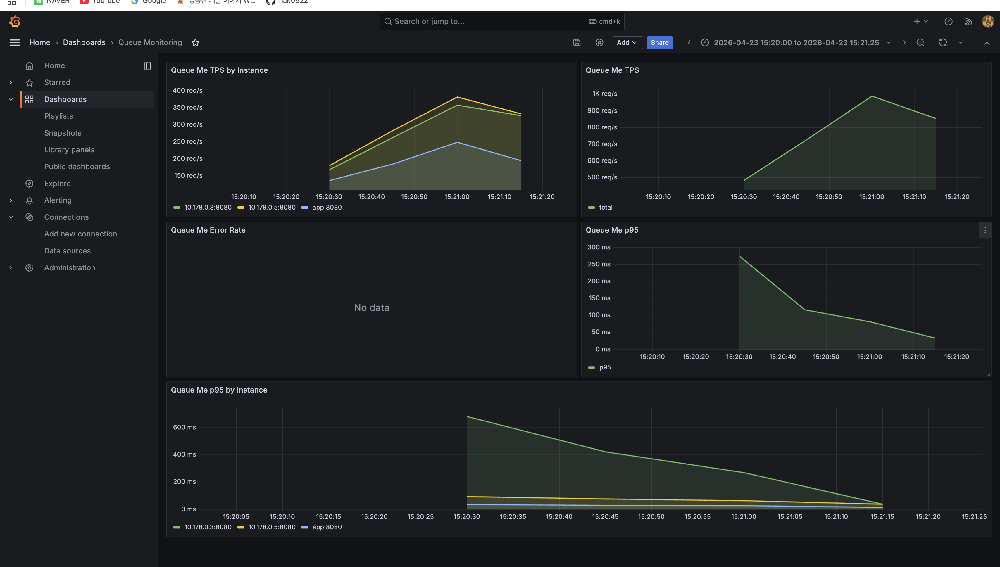

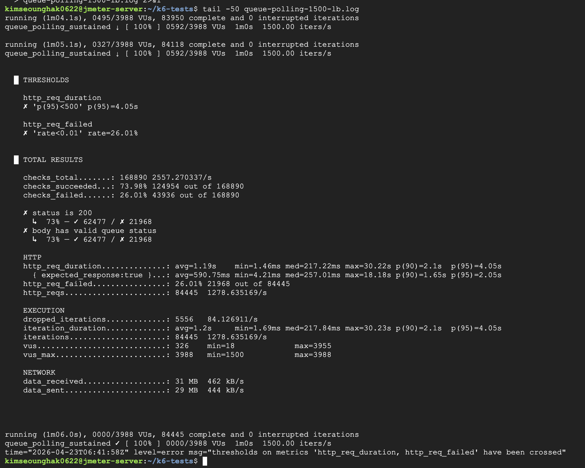

3대로 늘린 뒤 1,000 req/s는 안정화됐지만 1,500 req/s는 여전히 실패. 현재 브레이크포인트는 **1,000 ~ 1,500 req/s 사이**입니다.

### 4. Adaptive Polling 적용

고정 5초 polling 기준으로 10,000명이 만들어내는 2,000 req/s를 줄이기 위해 서버가 `nextPollMs`를 반환하도록 변경했습니다.

- `position <= 1,000` → `5,000ms` (앞순번: 빠른 조회)
- `position > 1,000` → `10,000ms` (뒷순번: 느린 조회)
- 기대 부하: 1,000 × 1/5s + 9,000 × 1/10s = **1,100 req/s** (45% 감소)

<!-- 이미지: Adaptive Polling 적용 후 k6 req/s 그래프 (nextPollMs 반영 결과) -->

정책 자체는 의도대로 동작했지만, 10,000 VU closed-model로 그대로 검증하려 하자 부하발생기의 thundering herd 문제가 먼저 드러났습니다. **"서버 한계 테스트(constant-arrival-rate)"와 "운영 정책 효과 검증(VU 기반)"은 분리해서 봐야 한다**는 점을 정리했습니다.

### 5. 예매 동시성 — Redis 캐시 + HikariCP 튜닝

polling 브레이크포인트를 확인한 뒤에는, 별개 축으로 **booking API 자체가 동시에 몰려도 정합성과 처리량을 유지하는지**를 다시 검증했습니다.

대기열 테스트와 별개로, GCP 이전 후 예매 자체의 처리량을 확인했습니다. JMeter SyncTimer로 300명이 동시에 출발하는 조건에서 300석 콘서트를 예매하는 시나리오입니다.

**테스트 환경**: GCP e2-medium 2대, JMeter SyncTimer 300명 동시 출발, 300석 콘서트

**적용한 최적화 목록**

| 변경 항목 | 변경 내용 | 이유 |
|---|---|---|
| HikariCP pool-size | 50 → **20** | pool=50에서 hot-row contention 심화 확인 (Phase 1 실험 동일 원인) |
| Redis 상태 캐시 | 없음 → `concert:status:{id}` TTL 30s | 예매마다 `SELECT Concert` DB 조회 제거 |
| `getReferenceById()` | `findById()` → 프록시 참조 | 캐시 히트 시 DB 조회 없이 FK 연관만 설정 |
| 캐시 무효화 | 없음 → 콘서트 삭제·수정 시 자동 제거 | 캐시 TTL 만료 전 정합성 보장 |

**측정 결과 비교**

| 구성 | TPS | 평균 응답 시간 | 중앙값 | p90 | p95 | 에러율 |
|---|---:|---:|---:|---:|---:|---:|
| 배치 튜닝만 적용 | 47.7/sec | 2,775ms | 2,088ms | 5,761ms | 6,049ms | 있음 |
| 낙관적 락 (`pool=10`) | 59.8/sec | 2,786ms | 2,632ms | 4,429ms | 4,723ms | 0% |
| HikariCP `pool=50` | 61.3/sec | 3,576ms | 3,468ms | 4,633ms | 4,807ms | 0% |
| **현재 코드 변경 후** (`pool=20` + Redis 상태 캐시) | **74.1/sec** | **2,993ms** | **2,974ms** | **3,808ms** | **3,945ms** | **0%** |

<!-- 이미지: JMeter GCP 2서버 300명 예매 결과 (74.1 TPS) -->

Redis 좌석 차감은 이미 원자적이라 동시성 오류 없이 0% 에러를 유지했습니다. pool 과다 설정이 hot-row contention을 키운다는 Phase 1의 결론이 GCP 환경에서도 동일하게 재확인됐습니다.

</details>

---

<a id="트러블슈팅"></a>

## 🚨 트러블슈팅

<details>
<summary><strong>입장권 소비 중 TTL 만료 타이밍 충돌 — EXISTS와 DEL 사이의 틈</strong></summary>

### 문제 상황

초기 구현에서 입장권 소비를 `EXISTS` 확인 후 `DEL`로 처리했습니다. 이 방식에서 입장권이 없는 사용자가 예매를 통과하는 케이스가 발생했습니다.

### 원인 탐색

`EXISTS`와 `DEL`은 별개의 Redis 명령입니다. Java에서 순차 호출하면 두 명령 사이에 시간 간격이 있습니다.

```
EXISTS → true
  ... 이 사이에 TTL 만료 ...
DEL → "성공" (없는 키를 DEL해도 Redis는 에러를 반환하지 않음)
→ 예매 진행  ← 입장권이 없는 상태에서 통과
```

`DEL`의 반환값이 0(삭제할 키 없음)이어도 코드에서 이를 확인하지 않았습니다.

### 선택지를 비교했습니다

**방법 1: DEL 반환값 확인**
DEL이 0을 반환하면 이미 만료된 것으로 처리합니다. EXISTS + DEL 두 명령이 따로 실행되는 건 동일해서 EXISTS와 DEL 사이에 만료가 발생하면 EXISTS는 true를 반환했지만 DEL 결과는 0이 됩니다. 이 경우는 잡을 수 있습니다. 하지만 DEL 이후 만료가 발생하는 경우는 잡지 못합니다. 그리고 근본적으로 두 명령 사이의 타이밍 의존성이 남습니다.

**방법 2: SET NX EX 뮤텍스 방식**
아예 입장권 소비를 별도 키 점유 방식으로 교체할 수 있습니다. 구조가 달라져 기존 TTL을 복원하는 로직을 만들기 어렵고, 설계 복잡도가 올라갑니다.

**방법 3: Lua Script**
EXISTS → TTL → DEL을 Redis 서버에서 원자적으로 실행합니다. 세 명령이 끊기지 않고 단위 실행되기 때문에 TOCTOU가 발생하지 않습니다. 추가로 TTL 반환값을 활용해 DB 처리 실패 시 입장권을 원래 잔여 TTL로 복원하는 기능도 얻었습니다.

Lua Script의 단점(디버깅 난이도)은 있지만, 세 줄짜리 스크립트이고 동작이 명확합니다. 방법 1은 타이밍 의존성을 완전히 제거하지 못하고, 방법 2는 기존 구조를 너무 크게 바꿉니다.

```lua
-- CLAIM_ADMITTED: EXISTS → TTL → DEL 원자적 처리, 없으면 -1 반환
if redis.call('EXISTS', key) == 0 then return -1 end
local ttl = redis.call('TTL', key)
redis.call('DEL', key)
return ttl
```

### 결과

입장권이 없거나 만료된 상태에서 예매 시도가 정확히 차단됩니다. DB 처리 실패 시 반환받은 TTL로 입장권을 복원해 재시도를 허용할 수 있게 됐습니다.

</details>

<details>
<summary><strong>Outbox 상태가 처리 후에도 PENDING으로 남았다 — detached 엔티티 함정</strong></summary>

### 문제 상황

보상 처리 로직이 실행됐는데도 `PaymentCompensationOutbox` 상태가 `PUBLISHED`나 `FAILED`로 바뀌지 않았습니다. 같은 Outbox가 스케줄러에 의해 반복 조회되어 보상 처리가 중복 시도됐습니다.

### 원인 탐색

로그에는 `outbox.markPublished()` 호출이 분명히 찍혔습니다. 예외도 없었습니다. 그런데 DB를 직접 조회해보면 상태가 그대로입니다.

JPA dirty checking이 동작하려면 엔티티가 현재 영속성 컨텍스트에서 관리되는 **managed 상태**여야 합니다. 스케줄러 메서드에는 `@Transactional`이 없었습니다. `findByStatus()`를 호출하면 Spring Data JPA가 내부적으로 짧은 트랜잭션을 열고 바로 닫습니다. **이 순간 반환된 엔티티는 detached 상태가 됩니다.**

이 detached 엔티티를 `REQUIRES_NEW` 트랜잭션을 가진 Processor로 그대로 넘기면, 새 영속성 컨텍스트는 이 엔티티를 관리하지 않습니다. 아무리 `markPublished()`를 호출해도 자바 객체의 필드값만 바뀔 뿐, DB UPDATE는 발생하지 않습니다.

### 선택지를 비교했습니다

**방법 1: entityManager.merge(outbox)**
detached 엔티티를 영속성 컨텍스트에 재등록합니다. 동작하지만, merge는 전달된 엔티티의 현재 상태를 DB에 그대로 반영합니다. 엔티티가 조회된 시점 이후로 다른 트랜잭션에서 상태가 바뀐 게 있다면 stale 데이터로 덮어쓸 위험이 있습니다.

**방법 2: 스케줄러에 @Transactional 추가**
전체 Outbox 처리를 하나의 트랜잭션으로 묶으면 엔티티가 managed 상태를 유지합니다. 그러나 Outbox A 처리 중 예외가 발생하면 Outbox B까지 함께 롤백됩니다. Outbox별 독립 처리라는 패턴의 의미가 사라집니다.

**방법 3: ID만 전달하고 Processor 안에서 재조회**
`REQUIRES_NEW` 트랜잭션 내부에서 엔티티를 새로 조회하면 항상 managed 상태가 보장됩니다. 항상 최신 DB 상태를 읽어오기 때문에 stale 데이터 덮어쓰기 위험도 없습니다.

```java
// Before: detached 엔티티를 그대로 전달
outboxProcessor.process(outbox);

// After: ID만 전달 → REQUIRES_NEW 트랜잭션 내부에서 재조회
outboxProcessor.process(outbox.getId());
```

### 결과

Outbox 상태가 정상적으로 `PUBLISHED`/`FAILED`로 반영됐습니다. `@Transactional`을 붙이는 것만큼이나, 어떤 트랜잭션에서 로드된 엔티티인지를 신경 써야 한다는 걸 배웠습니다.

</details>

<details>
<summary><strong>외부 PG 지연에 대한 대기 제한과 호출 차단 — 타임아웃·Circuit Breaker</strong></summary>

### 문제와 보호하려는 범위

PG 응답을 동기적으로 기다리는 동안 호출 스레드는 다른 작업을 처리하지 못합니다. 외부 API가 지연되는 상황에서 요청이 계속 들어오면 스레드 점유와 대기가 늘어날 수 있습니다. 따라서 개별 HTTP 호출의 대기를 제한하고, 장애 징후가 누적되면 추가 PG 호출을 줄이는 보호가 필요했습니다.

이는 외부 호출의 자원 점유 문제입니다. 승인 응답을 받지 못했을 때 실제로 결제됐는지를 판단하고 복구하는 문제는 별도의 Saga가 담당합니다. 과거 설명의 timeout 즉시 결제 실패·Outbox 생성 경로는 현재 PG 처리에 적용하지 않습니다.

### 대안을 비교했습니다

| 방법 | 보호 범위와 한계 |
|---|---|
| 타임아웃만 적용 | 연결·응답 대기를 제한하지만 PG 장애가 지속돼도 각 요청이 다시 호출하고 타임아웃까지 기다릴 수 있음 |
| Bulkhead로 동시 호출 제한 또는 전용 스레드 풀 격리 | PG가 점유할 동시 실행량을 별도로 제한할 수 있지만 용량·대기열·거절 정책 설계가 필요. 현재 미구현 |
| 타임아웃과 Circuit Breaker 결합 | 개별 대기를 제한하고 실패·느린 호출 비율에 따라 후속 호출을 거부. 동시 호출 수를 제한하는 Bulkhead를 대체하지는 않음 |

현재는 세 번째 보호를 적용했습니다. Circuit Breaker가 있어도 회로가 열리기 전이거나 호출이 허용된 동안에는 동기 호출 스레드가 대기하므로, 외부 장애를 완전히 격리했다고 표현하지 않습니다.

### 현재 설정과 적용 경로

결제 API는 `PaymentService → PaymentSaga → TossPaymentClient`로 이어집니다. PG 클라이언트의 승인·조회·취소 메서드에는 모두 `@CircuitBreaker(name = "toss")`가 적용돼 있으며 연결·읽기 타임아웃은 각각 3초입니다. PG HTTP는 DB 트랜잭션 밖에서 실행합니다.

| 항목 | 현재 코드·설정 |
|---|---|
| 연결·읽기 타임아웃 | 각각 3초. 전체 결제 API의 3초 완료 보장이 아님 |
| 호출 결과 집계 창 | 최근 10건 |
| 회로 차단 판단 | 집계에 필요한 호출 수를 충족한 뒤 실패율 50% 또는 느린 호출 비율 80% 기준 |
| 느린 호출 판정 | 2초 기준. 이 설정 자체가 HTTP 호출을 2초에 중단하지는 않음 |
| Open 대기 설정 | 30초 |
| Half-open 시험 호출 | 3건 |

연속 실패 횟수가 아니라 집계된 비율로 판단합니다. 승인·조회·취소는 각 앱 인스턴스 안에서 같은 `toss` 회로를 공유합니다. 따라서 승인 실패로 회로가 열리면 복구용 조회·취소도 일시적으로 거부될 수 있습니다. 여러 앱이 하나의 전역 회로 상태를 공유하는 구조는 아닙니다.

### 호출이 거부돼도 결제 실패로 확정하지 않습니다

별도 성공값을 만들어 반환하는 fallback은 없습니다. 타임아웃이나 회로의 호출 거부 예외는 Saga가 받아, 현재 상태와 재시도 회차를 확인한 뒤 미확정 결제의 다음 확인을 예약합니다. PG에서는 승인·취소가 이미 완료됐을 수 있으므로 예외만으로 티켓을 반환하거나 보상 Outbox를 생성하지 않습니다.

Worker는 다음 재시도 대상이 되면 PG 결과를 조회합니다. 승인 완료와 예매 확정 가능 여부를 확인하면 결제·예매를 함께 확정하고, 명확한 최종 실패나 전액 취소를 확인한 경우에만 반환 Outbox를 저장합니다. 결과가 계속 불명확하면 재확인 대상으로 유지합니다.

### 검증 결과와 남은 한계

실제 MySQL·Redis와 로컬 HTTP PG를 사용해 현재 3초 타임아웃과 30초 회로 대기 설정을 유지한 전용 검증을 수행했습니다. Spring AOP 프록시를 통한 상태 전이·실제 HTTP 차단·Half-open 동시 호출 제한·실패율/느린 호출 경계와 결제 안전성 14건이 통과했습니다. 단순 예외 발생뿐 아니라 PG 도착 횟수·회로 이벤트·실제 승인/취소 효과와 DB·Redis 결과를 함께 확인했습니다.

별도 스케줄러 ON 검증 1건에서는 승인 응답이 유실된 결제 3건을 기존 Worker 주기·backoff로 자동 확정하고 회로가 CLOSED로 복귀하는 것을 확인했습니다. 이후 추가 스캔과 중복 요청에도 승인 효과는 요청별 1회, 티켓 반환은 0회였습니다. 기존 선택 회귀 164건도 통과했으며 상속 실행을 포함한 건수로 전체 저장소 테스트 통과를 뜻하지 않습니다.

첫 회귀에서는 테스트 게이트 설정의 컨텍스트 격리 결함으로 실행을 중단했습니다. 전용 속성으로 적용 범위를 제한한 뒤 자동 복구·회귀를 재실행했습니다. 실패 원인·스레드 덤프·초기 로그도 보존했으며 운영 코드는 변경하지 않았습니다.

단일 결제만 복구하면 시험 호출 3건을 채우지 못해 HALF_OPEN에 남을 수 있고, 승인 자체가 차단된 주문은 조회만으로 자동 승인되지 않습니다. 연결 타임아웃의 실제 네트워크 경계, 스레드 고갈 방지 효과·다른 API 성능 개선·Bulkhead 비교·실제 Toss 장애는 검증하지 않았습니다. 따라서 외부 장애 전파를 완전히 차단했다거나 최대 복구 시간을 보장한다고 표현하지 않습니다.

[전용 검증 결과·재현 방법·원본 위치](docs/payment-circuit-breaker-results.md) · [PG 클라이언트](src/main/java/studying/blog/service/TossPaymentClient.java) · [회로 설정](src/main/resources/application.yml) · [Saga 복구 처리](src/main/java/studying/blog/service/PaymentSaga.java)

</details>

<details>
<summary><strong>로그인 후 공연 목록 조회 시 CORS 에러 — 설정이 아닌 구조 문제였다</strong></summary>

### 문제 상황

배포 후 로그인 전에는 공연 목록이 정상 조회됐지만, 로그인 후에는 목록이 보이지 않았습니다. 브라우저 Network 탭에는 `CORS error`가 표시됐고 Provisional headers are shown 메시지가 함께 나타났습니다.

### 원인 탐색

처음에는 Spring Security나 Spring CORS 설정이 빠진 것으로 봤습니다. 그런데 로그인 전후 요청 흐름을 비교해보니 차이가 있었습니다.

- **로그인 전**: 단순 GET 요청 (Simple Request) → Preflight 없음
- **로그인 후**: `Authorization` 헤더 포함 → 브라우저가 Preflight(OPTIONS) 요청을 먼저 발송

Spring Security가 OPTIONS 요청을 인증 없이 허용하지 않아 Preflight가 401로 차단됐습니다. 아래 설정을 추가했습니다.

```java
.requestMatchers(HttpMethod.OPTIONS, "/**").permitAll()
```

Preflight는 통과했지만 여전히 CORS 에러가 발생했습니다. Network 탭에서 실제 요청 URL을 확인해보니 `https://acornpost.cloud/api/concerts`로, 프론트엔드가 EC2를 직접 호출하고 있었습니다. Nginx와 Spring Boot의 허용 Origin 설정이 완전히 일치하지 않아 브라우저에서 차단되는 구조였습니다.

결국 "어떤 Origin을 허용할지"를 맞추는 문제가 아니라, 프론트엔드가 다른 출처 서버를 직접 호출한다는 구조 자체가 문제였습니다.

### 선택지를 비교했습니다

**방법 1: Nginx + Spring Boot CORS 설정을 정밀하게 맞추기**

Nginx에서 `Access-Control-Allow-Origin`, `Allow-Headers`를 설정하고, Spring Boot에서도 동일한 Origin을 허용하면 해결됩니다. 그러나 두 계층의 설정이 조금이라도 어긋나면 다시 에러가 발생합니다. 환경(Vercel 도메인, 로컬, EC2)에 따라 허용 Origin이 달라지고, 로그인 후 `Authorization` 헤더가 붙으면 Preflight까지 추가로 고려해야 합니다. 설정에 의존하는 구조라 안정성이 낮았습니다.

**방법 2: Vercel rewrite로 프록시 구성 (선택)**

Vercel의 `rewrites`를 이용해 `/api/*` 요청을 서버사이드에서 EC2로 전달합니다. 브라우저 입장에서는 Vercel 도메인 안에서 요청이 완결되어 CORS 자체가 발생하지 않습니다. 설정이 `vercel.json` 한 곳에만 존재하고, Nginx와 Spring Boot의 CORS 설정 의존성이 사라집니다.

```json
{
  "rewrites": [
    {
      "source": "/api/:path*",
      "destination": "https://acornpost.cloud/api/:path*"
    }
  ]
}
```

프론트엔드 환경변수도 EC2 직접 주소에서 상대 경로로 변경했습니다.

```
VITE_API_BASE_URL=/api
```

CORS를 "설정으로 해결"하는 대신, 애초에 발생하지 않는 구조로 바꾸는 것이 더 안정적이라고 판단했습니다.

### 결과

요청 흐름이 `브라우저 → Vercel(/api) → Vercel 서버 → EC2`로 바뀌어, 브라우저 기준 동일 출처 요청이 됩니다. CORS 에러 없이 로그인 전후 모두 정상 동작합니다. CORS 문제는 허용 설정을 맞추는 문제가 아니라 요청 구조 설계의 문제일 수 있습니다. Preflight가 발생하는 맥락(헤더 포함 여부)을 먼저 파악하면 원인을 빠르게 좁힐 수 있습니다.

</details>

---

<a id="db-인덱스-최적화"></a>

## ⚡️ DB 인덱스 최적화

<details>
<summary><strong>스케줄러 쿼리가 10만 건 기준 Full Table Scan — 복합 인덱스로 약 22배 개선</strong></summary>

### 문제 의식

`BookingExpiryScheduler`는 60초마다 아래 쿼리를 실행합니다.

```sql
SELECT * FROM booking
WHERE status = 'PENDING_PAYMENT'
  AND created_at < NOW() - INTERVAL 30 MINUTE
ORDER BY created_at ASC
LIMIT 1000;
```

처음에는 "스케줄러 쿼리니까 응답 시간이 좀 길어도 괜찮겠지"라고 생각했습니다. 그런데 데이터가 쌓일수록 이 쿼리가 부담이 된다는 걸 확인하고 싶었습니다. 10만 건 데이터를 넣고 `EXPLAIN`을 실행했습니다.

**Before — EXPLAIN**

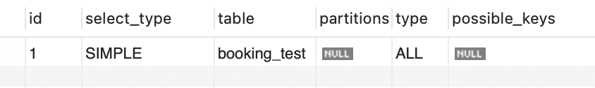

`type=ALL`, `key=NULL` — 인덱스를 전혀 사용하지 않고 10만 건 전체를 읽은 뒤 조건 필터링을 합니다.

**Before — 실행 시간 (5회 평균)**

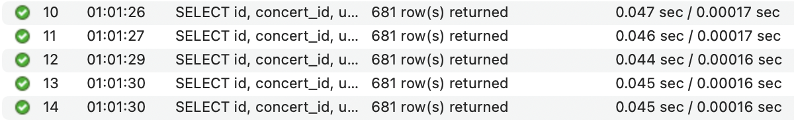

평균 **45~50ms**.

### 인덱스 설계 고민

`status` 단독 인덱스와 `(status, created_at)` 복합 인덱스 두 가지를 고려했습니다.

`status` 단독 인덱스는 `PENDING_PAYMENT` 건만 골라낼 수 있지만, 그 이후 `created_at` 범위 필터는 여전히 별도 필터링이 필요합니다. 복합 인덱스 `(status, created_at)`는 status로 먼저 범위를 좁힌 뒤 created_at 순서로 바로 읽어나갈 수 있습니다.

쿼리에서 `status =` 조건이 등치 비교이고 `created_at <`가 범위 조건이라 복합 인덱스의 컬럼 순서가 중요합니다. status를 앞에 두면 created_at 범위 스캔을 인덱스 안에서 처리할 수 있습니다.

```sql
CREATE INDEX idx_booking_status_created_at ON booking(status, created_at);
```

**After — EXPLAIN**

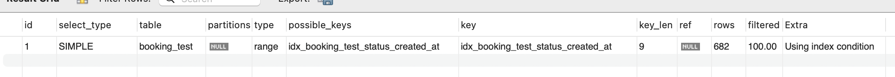

`type=range`, `key=idx_booking_test_status_created_at`, `Using index condition` — Index Range Scan으로 전환됩니다.

**After — 실행 시간 (5회 평균)**

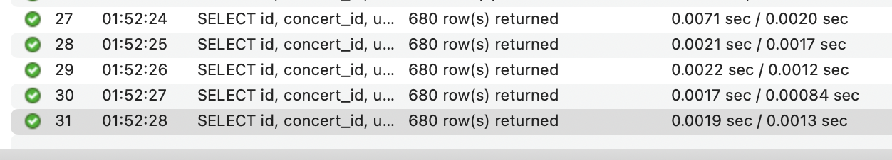

평균 **1.7~2.2ms**.

### 결과 요약

| 항목 | Before | After |
|---|---|---|
| 실행 계획 | `type=ALL` (Full Table Scan) | `type=range` (Index Range Scan) |
| 사용 인덱스 | `NULL` | `idx_booking_status_created_at` |
| 평균 실행 시간 | ~45ms | ~2ms |

> 만료 조회 쿼리(`created_at < X`)는 조건 범위가 넓어 인덱스 후에도 읽는 데이터가 어느 정도 있습니다.  
> 양쪽 범위로 제한된 쿼리에서는 약 22배 개선도 확인했습니다.

</details>

---

<a id="참조-문서"></a>

## 📂 참조 문서

- [현재 문서 안내](docs/README.md) — 최신 설계·실행·대표 결과·과거 기록의 읽는 순서
- [예매 생성 복구](docs/booking-hold-recovery.md) — 5분 선점 유지와 안전한 반환

- [`docs/architecture.md`](docs/architecture.md) — 패키지 구조, Redis 키 명세, Lua Script, Scheduler 상세
- [`docs/flow.md`](docs/flow.md) — 예매/보상/만료 시퀀스 다이어그램, 상태 전이
- [`docs/api.md`](docs/api.md) — 전체 REST 엔드포인트 목록
- [`docs/testing.md`](docs/testing.md) — 테스트 전략, 클래스별 설명, 실행 환경
