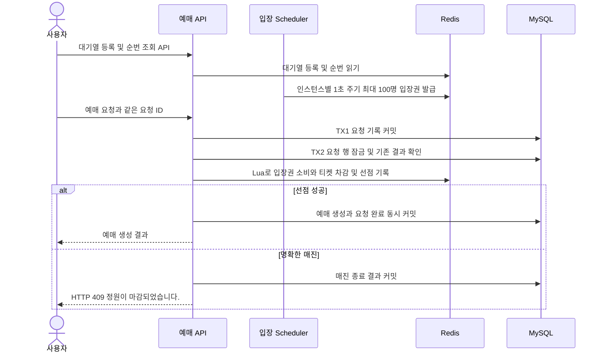
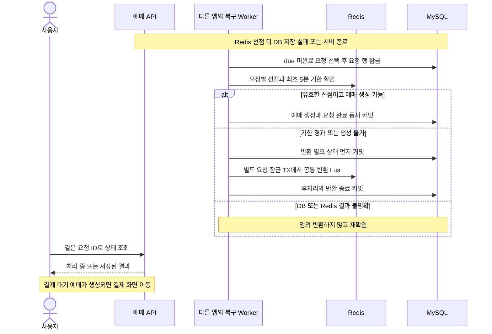
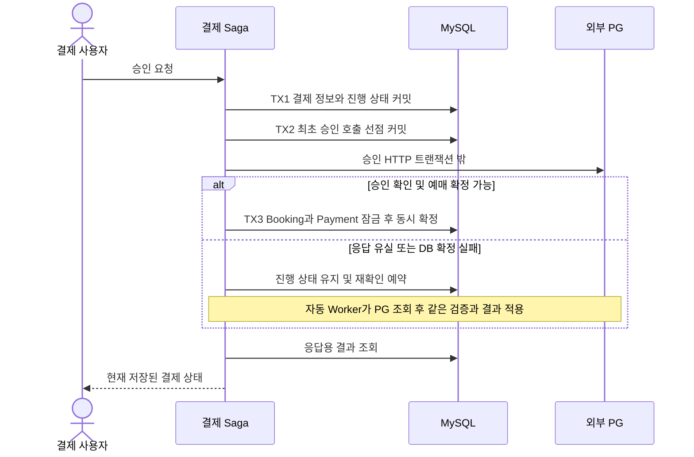

# 현재 예매·결제 흐름

2026-11-12 소스 대조 기준. [아키텍처·상태·잠금](architecture.md) · [API](api.md) · [검증 범위](testing.md).

## 대기열과 정상 예매

입장권은 발급부터 10분간 유효한 예매 시작 권한이며 재고 선점이 아니다. 같은 요청은 기존 결과를 사용한다. 선점된 재고에서 예매 내역을 생성한 뒤 사용자가 별도로 결제를 진행한다.

## 저장 실패와 서버 종료 후 복구

API에서 감지한 저장 예외도 새 잠금 조회로 DB 커밋 결과를 먼저 확인한다. 이미 저장됐다면 추가 차감 없이 기존 결과를 사용한다. 유효한 선점 재시도는 기한을 연장하지 않는다. 미선점 요청을 Worker가 새로 선점하지 않으며 정상 매진 표식은 반환 없이 거절로 복구한다.

화면은 사용자·공연별 요청 ID를 sessionStorage에 유지해 새로고침에도 조회한다. 처리 중에는 5초, 통신 실패는 10초 간격으로 확인하고 10분 뒤 자동 조회만 중단한다. 404는 접수 전 실패 가능성이 있어 ID를 지우지 않고 버튼으로 같은 ID 재전송을 안내한다. 이 버튼은 조회 전용이 아니라 POST 재전송이다. 실패 종료가 확인되면 새 시도를 안내한다. 공연이 SOLD_OUT이어도 기존 요청 확인은 가능하다. 브라우저를 닫아도 Worker는 실행되며 생성된 예매는 내 예매에서 확인할 수 있다. PG 자동 승인은 없다.

## PG 승인과 결과 재확인

최초 PG 호출은 결제 준비와 호출 선점 커밋을 확인한 뒤 진행한다. 예외 시 추가 트랜잭션이 생길 수 있어 전체를 항상 두 번의 트랜잭션이라고 설명하지 않는다. 조회·승인·취소 HTTP 동안 DB 트랜잭션을 유지하지 않는다. 결과 적용은 Booking→Payment 순서로 잠근다.

같은 결제를 여러 Worker가 조회할 수 있다. 선택 당시 회차와 현재 DB가 일치하는 첫 실패만 다음 재시도를 예약한다. 이미 선택한 정상 결과는 오래된 회차라는 이유만으로 버리지 않고 현재 상태와 PG 주문·금액을 검증한다. 완료된 결제를 뒤늦은 실패가 덮어쓰지 못한다.

SDK 결제창 이전에 내구성 있는 주문을 선생성하는 구조는 아니다. Mock `/payment`는 설정으로 허용하는 별도 SETNX 경로이며 실제 PG 경로의 승인 호출 선점과 구분한다.

## 취소·Outbox·반환

1. 승인은 확인됐지만 예매 확정이 불가능하거나 취소 의도가 있으면 취소 진행 상태를 먼저 저장한다. 늦은 승인 응답으로 취소 결정을 뒤집지 않는다.
2. PG 전액 취소 요청도 트랜잭션 밖에서 수행한다. 응답이 불명확하면 재조회하며 확인 전 티켓을 반환하지 않는다.
3. 전액 취소 확인 후 결제 취소와 반환 Outbox를 같은 트랜잭션에서 저장한다. 명확한 최종 승인 실패도 실패 기록과 Outbox를 함께 저장한다. timeout/404만으로 실패를 확정하지 않는다.
4. 자동 Outbox 처리에서 Booking을 잠그고 결제 이력을 검사한 뒤 예매 요청 행을 잠가 부당 반환을 보호한다. 취소가 가능하면 Booking 취소와 반환 필요 상태를 먼저 커밋한다.
5. 별도 요청 잠금 트랜잭션에서 Lua 반환·현재 잔여 수량 확인·공연 상태 후처리·요청 반환 종료를 처리한다. CLOSED는 임의 OPEN으로 바꾸지 않는다.
6. Redis 반환 직후 종료돼도 요청별 RETURNED 기록으로 중복 증가를 막고 남은 후처리를 재개한다. Outbox는 후속 커밋에서 PUBLISHED가 된다.
7. 예약 만료도 같은 보호·반환 경로를 사용한다. Booking 생성 후 30분은 만료 후보 기준이며 미확정/완료 결제가 있으면 보류한다.

PG 취소, 티켓 반환, Outbox 완료는 서로 다른 시점이다. 이미 처리할 필요 없는 작업의 무변경 종료도 PUBLISHED가 될 수 있다. 상태 정의는 [아키텍처](architecture.md), 정책과 배포 조건은 [예매 복구 상세](booking-hold-recovery.md)를 따른다.
