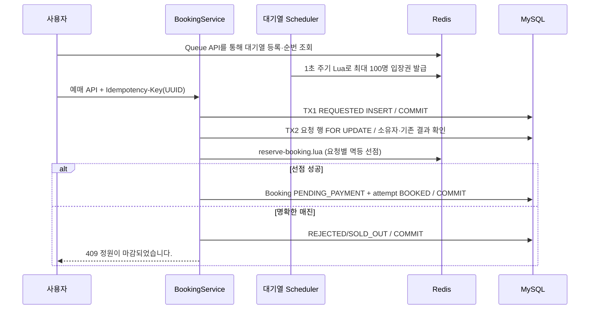
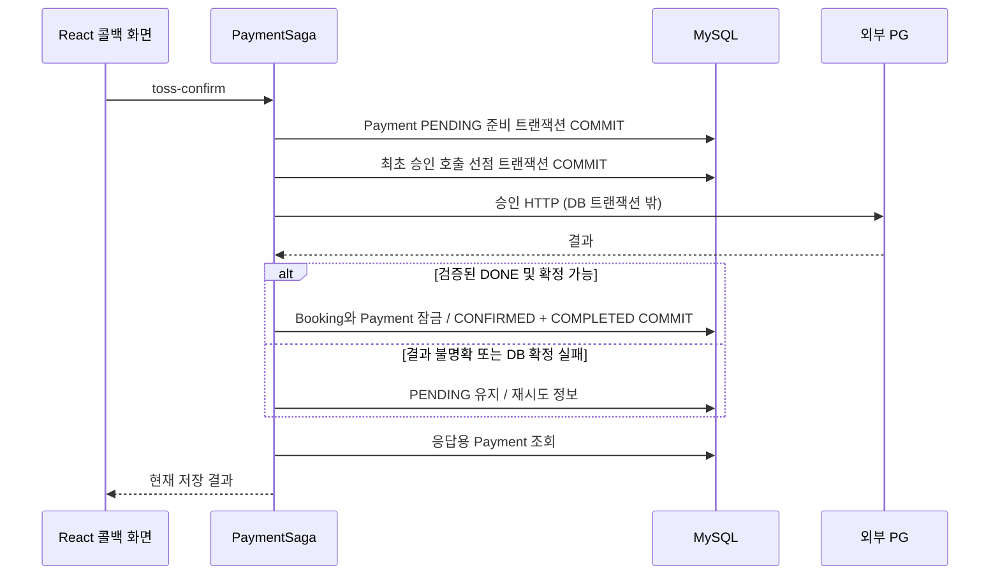

# 현재 예매·결제 흐름

2026-11-10 기준. 클래스와 잠금 경계는 [아키텍처](architecture.md), 미검증 사항은 [결제 결과](payment-saga-results.md)를 참고한다.

## 대기열 → 예매

기존 BOOKED/매진 결과는 재사용한다. 예외에서는 새 잠금 조회로 결과를 확인하고, 실패 확정 시 RELEASE_PENDING 선커밋 후 공통 반환을 실행한다. 커밋 불명확이면 202 BOOKING_PROCESSING으로 보류한다. Worker가 요청별 표식과 DB 상태로 복구하며 Redis 매진 표식만 있는 요청은 반환 없이 REJECTED/SOLD_OUT으로 종료한다.

## PG 결제

서버가 기록하기 전 SDK 결제창 단계까지 내구성 있는 주문을 선생성하는 구조는 아니다. Mock `/payment`는 별도 경로이며 Redis SETNX와 DB 유니크 제약을 사용한다. PG 경로에 Mock SETNX가 있다고 설명하지 않는다.

## 결제 재확인·취소·티켓 반환

1. PaymentRecoveryWorker가 due PENDING을 조회한다. PG HTTP 후 Booking→Payment 잠금으로 결과를 적용한다.
2. DONE이면 예매 확정 재시도. Booking이 이미 CANCELLED이면 취소 의도와 고정 취소 멱등키를 사용한다.
3. PG 전액 취소를 확인한 뒤 Payment CANCELED + 반환 Outbox를 같은 트랜잭션에서 커밋한다. 명확한 최종 승인 실패는 FAILED + Outbox다. timeout/404만으로 종료하지 않는다.
4. Outbox Processor → BookingSeatReleaseService → BookingAttemptTransactions.cancel. Booking 잠금 안에서 미확정/완료 결제가 있으면 보류한다.
5. 취소 가능하면 Booking CANCELLED + attempt RELEASE_PENDING 커밋 → 별도 release 트랜잭션의 Lua → RELEASED. 응답 유실 시 같은 요청 ID로 재실행하며 중복 증가하지 않는다.
6. BookingExpiryScheduler도 같은 취소·반환 경로를 사용한다. 결제 선커밋 이후 30분이 지났다고 미확정 티켓을 반환하지 않는다.

PG 취소 완료와 티켓 반환 완료는 서로 다른 단계다. Payment CANCELED만으로 전체 보상 완료라고 판단하지 않는다. 기존 Outbox의 PUBLISHED에는 이미 확정되어 적용할 필요 없는 무변경 종료도 포함될 수 있다.
